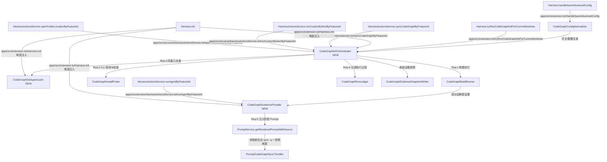

# 设计文档
## 1. 概述
本设计面向 CodeGraph 能力在 Fun Harness 主流程中的受控接入，覆盖 worktree 首次真实创建自动构建、缺图补偿触发、开关治理、缺失 CLI 自动安装尝试、失败非阻断、过程可追踪、五阶段证据注入，以及阶段前非阻断后台同步八个目标。

设计仅使用需求阶段 canonical domain：
- project-structure-init（Req-1, Req-2, Req-3, Req-4）
- domain-knowledge（Req-5）

本设计不修改实现代码，仅定义可追溯契约、数据模型、不变量与集成接缝。

## 2. 架构设计
### 2.1 架构图（Mermaid）


### 2.2 项目目录结构
- apps/src/services/codegraph/codeGraphInitOrchestrator.ts（新，编排入口）
- apps/src/services/codegraph/codeGraphDedupeGuard.ts（新，初始化窗口去重）
- apps/src/services/codegraph/codeGraphInstallProbe.ts（新，CLI 探测与自动安装）
- apps/src/services/codegraph/codeGraphBuildRunner.ts（新，构建执行与状态归一）
- apps/src/services/codegraph/codeGraphRunLedger.ts（新，.harness/process 过程记录）
- apps/src/services/codegraph/codeGraphEvidenceProvider.ts（新，证据包抽取与预算裁剪）
- apps/src/models.ts（改，Config 与模型扩展）
- apps/src/services/codegraph/codeGraphEvidenceSnapshotWriter.ts（新，初始化后证据快照落盘）
- apps/src/extension.ts（改，组合根注入与高级设置保存入口扩展）
- apps/src/services/harnessActionsService.ts（改，首次真实创建与补偿触发编排）
- apps/src/services/promptService.ts（改，五阶段证据注入位点 + 阶段前后台同步节流）

### 2.3 路由设计
1. 初始化触发路由（Req-1, Req-3, Req-4）
- 触发入口1：HarnessMessageController.handle(openFolderLocation) -> HarnessActionsService.openFolderLocationByFeatureId -> ensureIterationCodeBeforeOpen。
- 触发入口2：HarnessActionsService.runCustomButtonByFeatureId -> ensureIterationCodeBeforeOpen。
- 触发入口3：HarnessActionsService.syncCodeGraphByFeatureId（仅在目标 worktree 缺失 .codegraph 时触发补偿构建）。
- 触发入口4：Harness.tryRunCodeGraphInitForCurrentWorktree（用于直接打开已有 worktree 且缺图时的补偿初始化尝试，entryPoint 复用 openFolderLocationByFeatureId）。
- openFolderLocationByFeatureId 在 worktree 准备完成后触发初始化尝试；runCustomButtonByFeatureId 在 wasNewlyCreated=true 时触发。

2. 配置治理路由（Req-2）
- Webview saveAdvancedConfig -> HarnessMessageController.handle(saveAdvancedConfig) -> Harness.handleSaveAdvancedConfig。
- 通过 normalizeCodeGraphPolicyConfig 与保存入口归一化策略，保证 autoInstallEnabled 与 autoCodeGraphEnabled 同向。

3. Prompt 注入路由（Req-5）
- 阶段入口：HarnessActionsService.runAgentByFeatureId 调用 renderAgentPrompt。
- 注入点：PromptService.getRenderedPromptWithSource 在 req/des/tcs/tsk/dev 阶段读取 CodeGraphEvidenceProvider 输出。
- 同步策略：PromptService 在检测到 worktree 已存在 `.codegraph` 且未命中节流窗口时，后台执行 `codegraph sync -q`（失败不阻断），随后刷新证据快照。
- 降级策略：证据缺失或过期时，仅注入告警说明并回退原有 Prompt 逻辑。

### 2.4 集成接缝清单（Integration Points）
- CodeGraphInitOrchestrator -> 入边调用方真实代码坐标：HarnessActionsService.openFolderLocationByFeatureId / HarnessActionsService.runCustomButtonByFeatureId / HarnessActionsService.syncCodeGraphByFeatureId / Harness.tryRunCodeGraphInitForCurrentWorktree | 触发点：首次创建或缺图补偿初始化窗口 | Req-1, Req-3, Req-4
- CodeGraphDedupeGuard -> 入边调用方真实代码坐标：Harness.init（组合根依赖注入）+ CodeGraphInitOrchestrator.runOnce | 触发点：同 worktree 路径 + 进程会话去重判断 | Req-4
- CodeGraphInstallProbe -> 入边调用方真实代码坐标：CodeGraphInitOrchestrator.runOnce（编排器内部默认依赖） | 触发点：检测不到 codegraph 命令且 autoInstallEnabled=true | Req-3
- CodeGraphBuildRunner -> 入边调用方真实代码坐标：CodeGraphInitOrchestrator.runOnce（编排器内部默认依赖） | 触发点：安装成功或 CLI 已存在后执行构建 | Req-1, Req-4
- CodeGraphRunLedger -> 入边调用方真实代码坐标：CodeGraphInitOrchestrator.runOnce（编排器内部默认依赖） | 触发点：常规分支每次尝试结束（成功/失败/去重）写入过程记录 | Req-4
- CodeGraphEvidenceProvider -> 入边调用方真实代码坐标：HarnessActionsService.runAgentByFeatureId -> PromptService.getRenderedPromptWithSource | 触发点：生成 req/des/tcs/tsk/dev Prompt 前拉取证据包 | Req-5
- CodeGraphConfigNormalizer -> 入边调用方真实代码坐标：Harness.handleSaveAdvancedConfig | 触发点：保存高级设置与加载默认配置归一化 | Req-2
- PromptCodeGraphSyncThrottler -> 入边调用方真实代码坐标：PromptService.trySyncCodeGraphBeforeEvidence / PromptService.runBackgroundCodeGraphSync | 触发点：阶段 Prompt 装配前命中后台同步条件 | Req-5

## 3. 组件与接口设计
### 3.1 API 契约
1. API-1 初始化执行契约（domain: project-structure-init, Req-1/3/4）
- Caller: HarnessActionsService.ensureIterationCodeBeforeOpen 后置流程
- Contract: runOnce(input)
- input: { featureId, taskName, worktreePath, entryPoint, sessionId, autoCodeGraphEnabled, autoInstallEnabled }
- output: { status: success|warning|deduped, summary, startedAt, endedAt }
- 约束：同一 sessionId + worktreePath 在窗口内仅允许一次活跃构建

2. API-2 配置策略契约（domain: project-structure-init, Req-2）
- Caller: Harness.handleSaveAdvancedConfig 与 FeatureStoreService.loadConfig
- Contract: normalizeCodeGraphPolicyConfig(config)
- input: Config
- output: { autoCodeGraphEnabled, autoInstallEnabled, scope: git-config-compatible }
- 约束：配置缺省时 autoCodeGraphEnabled=true 且 autoInstallEnabled=true；保存与运行时归一化后 autoInstallEnabled 与 autoCodeGraphEnabled 同向

3. API-3 证据注入契约（domain: domain-knowledge, Req-5）
- Caller: PromptService.getRenderedPromptWithSource
- Contract: getStageEvidence(input)
- input: { worktreePath, stage:req|des|tcs|tsk|dev, budgetTokens, freshnessPolicy }
- output: { usable, freshness, anchors, seams, impactSet, bundlePath, warning? }
- 约束：freshnessPolicy=latest-success-record；freshness 基于最近成功 ledger 记录窗口（默认 24h）；usable=false 时必须返回 warning 且不得推断“无业务关系”

4. API-4 手动同步契约（domain: project-structure-init, Req-1/4）
- Caller: HarnessActionsService.syncCodeGraphByFeatureId
- Contract: syncCodeGraphByFeatureId(featureId)
- input: { featureId }
- output: { status: success|warning, summary }
- 约束：若 `.codegraph` 缺失则先触发一次初始化补偿；补偿后仍缺失必须告警并终止，不得执行盲同步

5. API-5 过程记录契约（domain: project-structure-init, Req-4）
- Caller: CodeGraphInitOrchestrator
- Contract: appendRunRecord(record)
- input: { worktreeId, worktreePath, entryPoint, startedAt, endedAt, status, summary, errorDigest?, dedupeReason? }
- output: { persisted, logPath }
- 约束：落位 .harness/process，不写 specs；常规分支记录可观测，异常抛出分支存在潜在漏记风险

### 3.2 数据模型
1. Model-1 CodeGraphPolicy（Req-2, domain: project-structure-init）
- autoCodeGraphEnabled: boolean（默认 true）
- autoInstallEnabled: boolean（默认 true，且与 autoCodeGraphEnabled 同向归一化）
- scope: git-config-compatible（与当前高级设置范围一致）

2. Model-2 CodeGraphRunRecord（Req-4, domain: project-structure-init）
- runId: string
- worktreeId: string
- worktreePath: string
- entryPoint: openFolderLocationByFeatureId | runCustomButtonByFeatureId | syncCodeGraphByFeatureId
- status: success | warning | deduped
- startedAt: string(ISO-8601)
- endedAt: string(ISO-8601)
- summary: string
- errorDigest?: string
- dedupeReason?: string

3. Model-3 CodeGraphEvidenceBundle（Req-5, domain: domain-knowledge）
- bundlePath: string
- freshness: fresh | stale | missing
- anchors: string[]
- seams: Array<{ caller: string; callee: string; relation: string }>
- impactSet: string[]
- warning?: string
- 说明：初始化快照可生成 anchors，但 seams/impactSet 可能为空，仍需保留不确定性告警语义

4. Model-4 DedupeWindowKey（Req-4, domain: project-structure-init）
- sessionId: string
- worktreePath: string
- 说明：当前以会话内存键（sessionId + normalizedWorktreePath）做活动窗口去重

### 3.3 组件 Props / Events
1. AdvancedSettings.CodeGraphToggle（Req-2）
- Props:
  - autoCodeGraphEnabled: boolean
  - autoInstallEnabled: boolean
- Events:
  - saveAdvancedConfig 扩展字段：acg(boolean), cai(boolean)
- 行为约束：页面重开时 UI 状态与持久化值一致

2. StagePromptAssembler（Req-5）
- Props:
  - stage: req|des|tcs|tsk|dev
  - worktreePath: string
  - budgetTokens: number
- Events:
  - onEvidenceAttached(bundleMeta)
  - onEvidenceFallback(warning)

### 3.4 Store 设计
1. Config Store（project-structure-init）
- 在 Config 增加：autoCodeGraphEnabled、autoInstallEnabled。
- DEFAULT_CONFIG 设定：true / true。
- FeatureStoreService.loadConfig 通过 merged 语义兼容历史配置。
 - 保存与运行时均执行归一化：autoInstallEnabled 与 autoCodeGraphEnabled 同向。

2. Runtime Process Store（project-structure-init）
- 记录目录：.harness/process/codegraph-runs.jsonl（或等价结构化文件）。
- 写入时机：每次构建尝试完成后（含 deduped）。
- 字段对齐 Req-4 可观测要求。

3. Evidence Cache Store（domain-knowledge）
- 按 worktreePath 缓存最近成功构建的证据元数据。
- freshness 以最近成功 run ledger 的 endedAt 与窗口阈值（默认 24h）判定。
- 若 freshness 不满足策略，则标记 stale 并触发降级告警。

## 4. 正确性属性（需求不变量）
1. INV-1（Req-1, project-structure-init）
- 若 wasNewlyCreated=true 且 autoCodeGraphEnabled=true，则必须触发一次构建编排；已有 worktree/缺图场景允许补偿触发。

2. INV-2（Req-2, project-structure-init）
- 配置缺省时 autoCodeGraphEnabled=true；关闭后新 worktree 初始化不得触发构建；重开后恢复触发。

3. INV-3（Req-3, project-structure-init）
- 当 CLI 缺失且 autoInstallEnabled=true，必须执行一次非交互安装尝试并记录结果；安装失败不阻断主流程。

4. INV-4（Req-4, project-structure-init）
- 对成功/告警/去重等常规分支 runAttempt，必须存在一条过程记录，包含 worktree 标识、入口、时间、状态、摘要；异常抛出分支需额外兜底保障。

5. INV-5（Req-4, project-structure-init）
- 对同一 DedupeWindowKey，在初始化窗口内活跃构建并发数 <= 1。

6. INV-6（Req-5, domain-knowledge）
- 阶段 Prompt 注入若证据 freshness=missing|stale，必须显式告警并回退，且不得得出“无业务关系”结论。

## 5. 错误处理
1. CLI 缺失
- 条件：探测不到 codegraph 命令。
- 处理：若 autoInstallEnabled=true 则安装尝试；否则 warning + 下一步建议。
- 绑定：Req-3, INV-3。

2. 自动安装失败
- 条件：安装命令返回非成功。
- 处理：记录 errorDigest，warning 通知，不阻断 worktree 打开与阶段流转。
- 绑定：Req-3, Req-4。

3. 构建超时/命令异常
- 条件：BuildRunner 超时或退出码异常。
- 处理：warning + run record + 主流程继续。
- 绑定：Req-4, INV-4。

3b. 构建流程异常抛出
- 条件：构建或探测流程发生未捕获异常抛出。
- 处理：主流程继续并告警；记录存在潜在缺口，后续由兜底策略补强。
- 绑定：Req-4, INV-4。

4. 并发重复触发
- 条件：同 sessionId + worktreePath 二次触发。
- 处理：DedupeGuard 返回 deduped，记录去重摘要，不再重复执行构建。
- 绑定：Req-4, INV-5。

5. 证据缺失或过期
- 条件：无有效 bundle 或 freshness=stale。
- 处理：注入 warning + 回退原流程，禁止输出否定性业务结论。
- 绑定：Req-5, INV-6。

## 6. 测试策略
1. 触发一致性测试（Req-1）
- 覆盖 openFolderLocationByFeatureId、runCustomButtonByFeatureId、syncCodeGraphByFeatureId 与 tryRunCodeGraphInitForCurrentWorktree 补偿触发场景，断言按入口条件触发同一编排。

2. 配置默认与持久化测试（Req-2）
- 缺省配置断言 autoCodeGraphEnabled=true, autoInstallEnabled=true，并校验归一化后保持同向。
- 保存后重开设置页断言 UI 与配置一致。

3. 安装分支测试（Req-3）
- CLI 缺失+策略开启：触发安装并记录。
- 安装失败：warning 且流程继续。

4. 去重与过程记录测试（Req-4）
- 并发触发断言仅一次活跃构建。
- 每次尝试均有完整 run record，deduped 亦记录。

5. 五阶段证据注入测试（Req-5）
- req/des/tcs/tsk/dev 各阶段在证据可用时注入锚点与接缝信息。
- stale/missing 场景断言降级 warning 与无错误否定推断。
- 阶段前后台同步仅作 best-effort，不阻断 Prompt 渲染。

## 7. 机器可读区
```yaml
artifactType: design
taskName: CodeGraph
apiContracts:
  - id: API-1
    domain: project-structure-init
    requirementIds: [Req-1, Req-3, Req-4]
    method: EVENT
    path: /internal/codegraph/init/run-once
    request:
      featureId: string
      taskName: string
      worktreePath: string
      entryPoint: openFolderLocationByFeatureId|runCustomButtonByFeatureId|syncCodeGraphByFeatureId
      sessionId: string
      autoCodeGraphEnabled: boolean
      autoInstallEnabled: boolean
    response:
      status: success|warning|deduped
      summary: string
      startedAt: string
      endedAt: string
  - id: API-2
    domain: project-structure-init
    requirementIds: [Req-2]
    method: EVENT
    path: /internal/codegraph/config/normalize-policy
    request:
      configRef: Config
    response:
      autoCodeGraphEnabled: boolean
      autoInstallEnabled: boolean
      scope: git-config-compatible
      normalizedWithAutoCodeGraph: boolean
  - id: API-3
    domain: domain-knowledge
    requirementIds: [Req-5]
    method: EVENT
    path: /internal/codegraph/evidence/get-stage-evidence
    request:
      worktreePath: string
      stage: req|des|tcs|tsk|dev
      budgetTokens: number
      freshnessPolicy: latest-success-record
    response:
      usable: boolean
      freshness: fresh|stale|missing
      anchors: [string]
      seams:
        - caller: string
          callee: string
          relation: string
      impactSet: [string]
      bundlePath: string
      warning: string?
  - id: API-4
    domain: project-structure-init
    requirementIds: [Req-1, Req-4]
    method: EVENT
    path: /internal/codegraph/sync/manual
    request:
      featureId: string
    response:
      status: success|warning
      summary: string
  - id: API-5
    domain: project-structure-init
    requirementIds: [Req-4]
    method: EVENT
    path: /internal/codegraph/process/append-run-record
    request:
      worktreeId: string
      worktreePath: string
      entryPoint: openFolderLocationByFeatureId|runCustomButtonByFeatureId|syncCodeGraphByFeatureId
      startedAt: string
      endedAt: string
      status: success|warning|deduped
      summary: string
      errorDigest: string?
      dedupeReason: string?
    response:
      persisted: boolean
      logPath: string
models:
  - id: Model-1
    domain: project-structure-init
    requirementIds: [Req-2]
    name: CodeGraphPolicy
    fields:
      - name: autoCodeGraphEnabled
        type: boolean
      - name: autoInstallEnabled
        type: boolean
      - name: scope
        type: string
  - id: Model-2
    domain: project-structure-init
    requirementIds: [Req-4]
    name: CodeGraphRunRecord
    fields:
      - name: runId
        type: string
      - name: worktreeId
        type: string
      - name: worktreePath
        type: string
      - name: entryPoint
        type: string
      - name: status
        type: string
      - name: startedAt
        type: string
      - name: endedAt
        type: string
      - name: summary
        type: string
      - name: errorDigest
        type: string?
      - name: dedupeReason
        type: string?
  - id: Model-3
    domain: domain-knowledge
    requirementIds: [Req-5]
    name: CodeGraphEvidenceBundle
    fields:
      - name: bundlePath
        type: string
      - name: freshness
        type: fresh|stale|missing
      - name: anchors
        type: string[]
      - name: seams
        type: object[]
      - name: impactSet
        type: string[]
      - name: warning
        type: string?
invariants:
  - id: INV-1
    domain: project-structure-init
    requirementId: Req-1
    rule: wasNewlyCreated=true 且 autoCodeGraphEnabled=true 时，必须触发一次初始化编排；已有 worktree/缺图场景允许补偿触发。
  - id: INV-2
    domain: project-structure-init
    requirementId: Req-2
    rule: 配置缺省时自动构建开关为开启；关闭后禁止触发；重开后恢复触发。
  - id: INV-3
    domain: project-structure-init
    requirementId: Req-3
    rule: CLI 缺失且自动安装策略开启时必须尝试一次安装并记录，不得阻断主流程。
  - id: INV-4
    domain: project-structure-init
    requirementId: Req-4
    rule: 成功/告警/去重等常规分支必须写入一条完整过程记录；异常抛出分支需额外兜底保障。
  - id: INV-5
    domain: project-structure-init
    requirementId: Req-4
    rule: 同一 sessionId+worktreePath 初始化窗口内活跃构建并发数不得超过 1。
  - id: INV-6
    domain: domain-knowledge
    requirementId: Req-5
    rule: 证据缺失或过期时必须告警降级，禁止将未查询到节点推断为不存在业务关系。
integrationPoints:
  - node: CodeGraphInitOrchestrator
    inboundFrom: HarnessActionsService.openFolderLocationByFeatureId / HarnessActionsService.runCustomButtonByFeatureId / HarnessActionsService.syncCodeGraphByFeatureId / Harness.tryRunCodeGraphInitForCurrentWorktree
    triggerPoint: 首次创建或缺图补偿初始化窗口
    requirementIds: [Req-1, Req-3, Req-4]
  - node: CodeGraphDedupeGuard
    inboundFrom: Harness.init（依赖注入）
    triggerPoint: runOnce 前执行 DedupeWindowKey 判定
    requirementIds: [Req-4]
  - node: CodeGraphInstallProbe
    inboundFrom: CodeGraphInitOrchestrator.runOnce（编排器内部默认依赖）
    triggerPoint: codegraph 命令缺失且 autoInstallEnabled=true
    requirementIds: [Req-3]
  - node: CodeGraphBuildRunner
    inboundFrom: CodeGraphInitOrchestrator.runOnce（编排器内部默认依赖）
    triggerPoint: CLI 可用后执行初始化构建
    requirementIds: [Req-1, Req-4]
  - node: CodeGraphRunLedger
    inboundFrom: CodeGraphInitOrchestrator.runOnce（编排器内部默认依赖）
    triggerPoint: 常规分支每次尝试结束后写入 .harness/process
    requirementIds: [Req-4]
  - node: CodeGraphEvidenceProvider
    inboundFrom: HarnessActionsService.runAgentByFeatureId -> PromptService.getRenderedPromptWithSource
    triggerPoint: req/des/tcs/tsk/dev 阶段 Prompt 组装前
    requirementIds: [Req-5]
  - node: CodeGraphConfigNormalizer
    inboundFrom: Harness.handleSaveAdvancedConfig
    triggerPoint: 保存高级设置与加载缺省配置归一化
    requirementIds: [Req-2]
  - node: PromptCodeGraphSyncThrottler
    inboundFrom: PromptService.trySyncCodeGraphBeforeEvidence / PromptService.runBackgroundCodeGraphSync
    triggerPoint: 阶段 Prompt 装配前命中后台同步条件
    requirementIds: [Req-5]
```